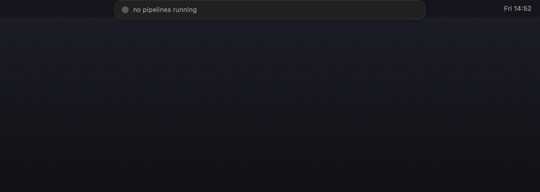

# Pipeline Island

GitLab CI pipelines, live in the macOS notch.



The island shows up when a pipeline starts, tracks it stage by stage, and
disappears when it's done. Hover for the full breakdown, click to open the run
in GitLab. On a display without a notch it sits under the menu bar instead.

macOS 14+, Swift 6, no third-party dependencies.

## Install

```bash
brew install --cask Uudg/tap/pipeline-island
```

Or from source:

```bash
git clone https://github.com/Uudg/pipeline-island
cd pipeline-island
make signing-identity   # once, stops repeated keychain prompts (not with sudo)
make app
open .build/debug/PipelineIsland.app
```

Either way you need a Swift toolchain — `xcode-select --install` if you don't
have one. Both routes compile on your machine.

Then click the menu bar icon, open Settings, and paste a GitLab token with the
`read_api` scope. There's a button that takes you straight to the token page.

There's no binary to download, and that's deliberate. Signing an app for
distribution needs a paid Apple Developer ID, and without one a downloaded build
just gets blocked by Gatekeeper with "is damaged and can't be opened".
Something you compiled yourself is never quarantined, so the problem doesn't
arise.

## Updating

```bash
brew upgrade --cask pipeline-island
```

The app checks GitHub once a day and puts an "Update available" entry in the
menu when there's a newer release. It never downloads or installs anything
itself — Homebrew does that.

## Settings

**Which projects** — everything you can see, only your own namespace, or pick
specific groups.

**Whose runs** — everyone's, or only pipelines you triggered. Being in a
company's GitLab group doesn't mean you want every colleague's push in your
menu bar.

**Which display** — the options are labelled with your actual monitors.

**Haptics** — a tap when something starts, passes, or fails. Needs a Force Touch
trackpad.

Your token goes in the macOS Keychain, never to disk. The app asks for keychain
access on first launch; that prompt is the whole point.

## Development

```bash
make run          # build and launch
make demo         # fake pipelines: no network, no keychain, no CI minutes
make demo-notch   # same, with a simulated notch (useful lid-closed)
make spikes       # regression suite
```

`make demo` exists because a real pipeline takes ~100 seconds and burns CI
minutes. The demo loops a passing run, a failing run, and three at once, so any
visual state is a few seconds away.

`spike/` holds small standalone programs that check assumptions against the real
API. They're there because a few obvious-looking designs turned out to be wrong
— querying pipelines through merge requests misses anything triggered by a push,
"my projects" isn't the same as "projects without a group", and the island was
sitting 425pt off-centre on a MacBook. Each spike now guards one of those.

More detail in [`docs/`](docs/).

## Licence

MIT
